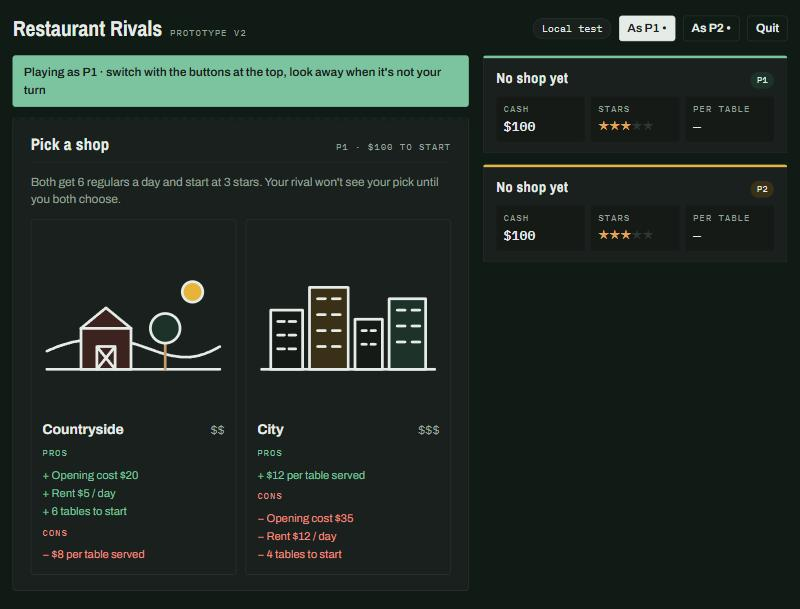
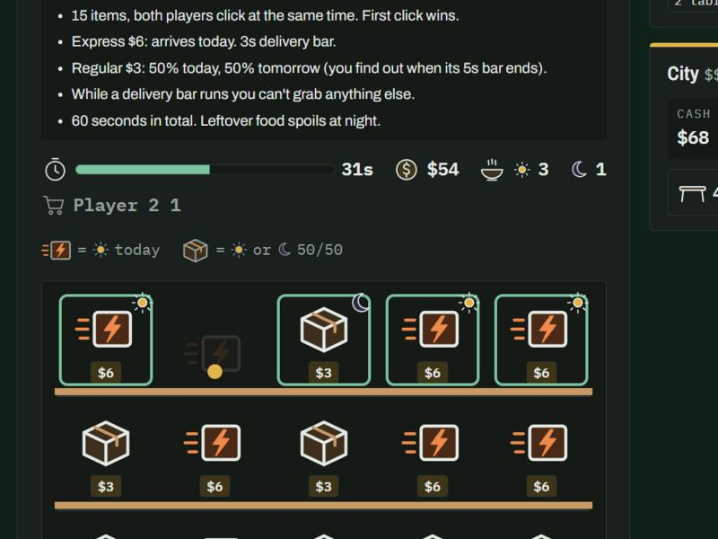
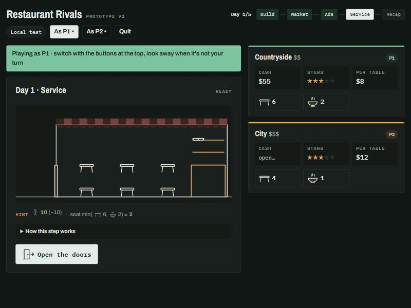
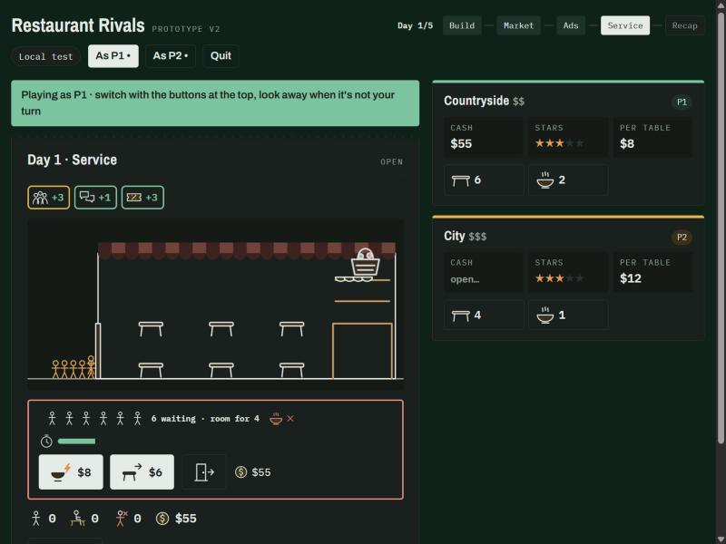
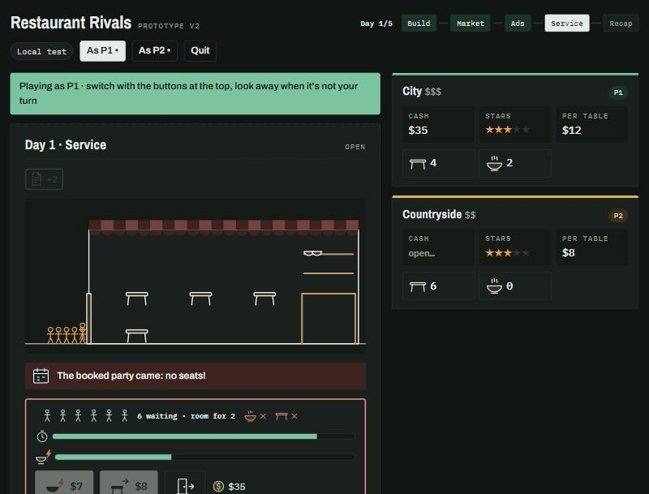
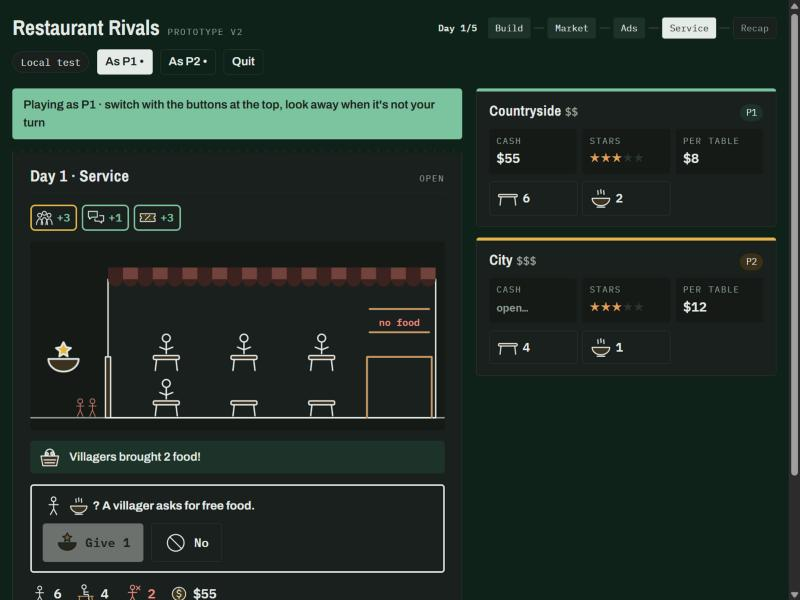

# Restaurant Rivals · online prototype v2

A two-player restaurant game you play on two devices in the browser. Game data lives in Firebase (Firestore + anonymous sign-in), so players don't need an account: open the page, type a room code, play.

Live site: https://paprikachen.github.io/cs377g_Project3/

## Files

| File | What it does |
| --- | --- |
| `index.html` | Entry page |
| `style.css` | Styles |
| `engine.js` | Game rules and numbers (edit the values in `CFG`) |
| `app.js` | Screens, online sync, local test mode |
| `art.js` | The line drawings: icons, shop pictures, the restaurant scene |
| `firebase-config.js` | Our Firebase web config |
| `firestore.rules` | Database security rules; paste into the Firebase console to publish |
| `tests/` | Automated tests |

## 1. Firebase setup (already done for this project)

Only needed if you make a new Firebase project.

1. Open the [Firebase console](https://console.firebase.google.com), sign in, and click **Add project**. Google Analytics is optional. The free Spark plan is enough.
2. **Turn on anonymous sign-in**: Build → Authentication → Get started → Sign-in method → enable **Anonymous**.
3. **Create the database**: Build → Firestore Database → Create database. Pick a nearby region and **production mode**.
4. **Publish the rules**: in Firestore's **Rules** tab, replace everything with the contents of `firestore.rules`, then click **Publish**.
5. **Get the web config**: gear icon → Project settings → Your apps → `</>` (Web). Skip Hosting. Copy the `firebaseConfig` values into `firebase-config.js`.
6. **Authorize the site**: Authentication → Settings → Authorized domains → add `paprikachen.github.io`.

## 2. Run it locally

The page uses ES modules, so double-clicking `index.html` won't work. Start a local server:

```
cd path/to/this/folder
python3 -m http.server 8000
```

Then open `http://localhost:8000`. `localhost` is authorized in Firebase by default.

To test online play by yourself: one browser can only be one player (the anonymous identity is saved per browser). Use a second device, a private window, or a different browser for player 2.

## 3. Publishing

Pushing to `main` updates GitHub Pages in about a minute. GitHub caches pages for a few minutes; if you still see the old version, hard-refresh (`Ctrl/Cmd + Shift + R`) or add `?v=2` to the URL.

**Branch previews.** `.github/workflows/pages.yml` deploys every branch to the `gh-pages` branch: `main` goes to the site root, and any other branch goes to `https://paprikachen.github.io/cs377g_Project3/preview/<branch>/` (lowercase, with `/` and other odd characters turned into `-`). The link also appears in the run summary under the repo's **Actions** tab. Deleting the branch removes its preview. Both players in a game must use the same URL, since a preview may run different rules than `main`. GitHub Pages must be set to **Deploy from a branch → `gh-pages` / (root)** (Settings → Pages).

## 4. How to play

1. Player 1 enters a name, clicks **Create room**, and sends the link and the 4-letter room code to player 2.
2. Player 2 opens the page, enters a name and the room code.
3. Each day: Morning (deliveries, robbery, warnings) → Build (tables + your private event) → Market (live: both click at once, first click wins, a cooldown bar after each buy) → Ads (a random shop each day; cards for your shop and tricks for your rival's, all face down) → Service (cards flip, guests arrive in groups; when you run short you get a few seconds to rush food or borrow a table) → Recap. Score after day 5.
4. After a refresh or a dropped connection, click **Back to [room]** to continue.

**Local test** needs no Firebase: one person plays both shops on one screen. Good for tuning numbers.

## Tuning the numbers

All rule values are in `CFG` at the top of `engine.js`:

- `loc.country` / `loc.city`: opening cost, rent, starting tables, income per table `price`
- `market`: daily stock, total time, Express / Regular price and cooldown, chance Regular arrives tomorrow, how far the split drifts from half
- `shop` and `ads`: how many cards the daily shop shows, and every ad card's price and effect
- `service`: patience, time per rush/borrow, their price ranges, chance the neighbour says no, villager chance, event chances and effects
- `emptyTables`, `robbery`: empty-table star penalty and overnight robbery
- `rep`: extra customers from high stars and their arrival chance, and the chance of losing regulars at low stars
- `voucher`: comp voucher price
- `loan.enabled`: loans are off (`false`); set to `true` to bring them back
- `starValue`: how much each star is worth in the final score

Save and refresh. **Both players must run the same version of the rules.** Changing numbers mid-game makes the two sides compute different results, so change them between games.

## v2 changes (2026-11-07)

Based on our in-group playtest notes (dominant strategies: buy everything early in the market, bluff every time, add lots of tables on day 1; plus several unclear rules), we reworked the prototype:

- **Live market**: 15 items on screen at once, both players click at the same time, first click wins. Express ($6) arrives today with a 3s cooldown; Regular ($3) arrives today or tomorrow (50/50, revealed when its 5s cooldown ends). 60 seconds in total. No Regular on day 5, with a warning on day 4. Tomorrow's food shows up on a new morning page.
- **Ad shop**: a new random shop for each player every day: 1 location card + 2 general cards for your own shop, 3 cards for your rival's shop (false advertisement, bad review, poach, swamp, fake booking, corner the rush supplier). Each card can be bought once; all cards are face down. No more bluffs on your own shop.
- **Interactive service**: guests arrive in groups. Only when tables or food run out, a popup gives you 8 seconds of patience to rush food ($7–10, 2s each) or borrow a table from next door ($5–8, 30% chance they say no), one at a time. Pop-up tables and rush food moved here from the old Prep step.
- **Events**: one random event per day (60%): someone asks for free food (villager / homeless man; give → 20% chance of +1 star, refuse → 50% chance of −1 star), a fight (−2 tables for good, −2 food), a proposal (50%: +$20 tip), a storm (countryside) or protest (city) (−3 guests). Villagers may bring 2 food when you run short in the countryside (15%). The shady deal and booking events are now per player and resolve during service. Overnight robbery: 5% chance, takes half your cash, at most $30. The countryside's free daily food is gone.
- **Stars**: more than half your tables empty at closing → 50% chance of −1 star.
- **Clarity**: skippable intro cards, a progress bar for the day, rules shown only for the current step, pros/cons on the shop pick, hints that do the math ("expect X guests · seat min(tables, food)").
- **Visuals (first pass)**: line drawings in `art.js`: the market is a shelf with two distinct icons, service is a drawn restaurant where stick figures walk to tables, ad cards and events have icons.

All new numbers are placeholders (marked TBD in `CFG`) until we playtest them.

### Screenshots from testing (local test mode, dark theme)

**Picking a shop**: pictures plus pros and cons.



**Live market shelf**: Express (bolt) vs Regular (box). Items you bought have your colour ring and a sun (today) or moon (tomorrow) badge; the faded slot with a dot was taken by the rival.



**Service, before opening**: your tables and the food on the counter.



**A shortage**: guests queue at the door; rush food, borrow a table, or let them go. Here the villagers also brought food. Flipped ad cards are the chips on top.



**Rush order on the way**: patience bar and delivery bar.



**Seated guests and an event**: seated guests sit at tables, turned-away guests stand outside in red, and a villager asks for free food.



These were taken mid-development: a few details have changed since (for example the villagers' basket now sits by the counter instead of covering the food shelf, and ad cards show short picture formulas instead of full sentences).

**Still to do**: the visuals and the writing are not intuitive enough yet. Both need a lot more revision and polish (clearer icons, less text, better feedback when things happen, checking phone layouts), and the numbers need balancing after real playtests.

## Ideas to try later (v2 alternatives)

- **Regular delivery reveal**: now you find out "today or tomorrow" when the cooldown bar ends. Alternative: keep it hidden until the doors open, so it's a real gamble.
- **Patience bar**: now the whole waiting group shares one bar. Alternative: each guest has their own bar and they leave one by one.

## Fairness

- When cards are placed, the rival sees only how many there are plus a checksum. Which cards they are is revealed at the flip and checked against the checksum, so it can't be changed afterward.
- The live market lives in `games/{code}/market/d{day}`; every click is a Firestore transaction, so two players can never get the same item. **After pulling v2, republish `firestore.rules` in the Firebase console** or the market won't work online.
- Service clicks (rush food, borrowing tables) happen on your own device and are saved to your log when you close for the day.
- Each player can only edit their own action log; `firestore.rules` enforces this.
- This is a class prototype: a technical player could work out dice rolls early with browser dev tools. Not a concern for playtesting.

## Free quota

The Spark plan allows 50,000 reads and 20,000 writes a day. One game uses a few hundred, which is plenty for class playtests.
